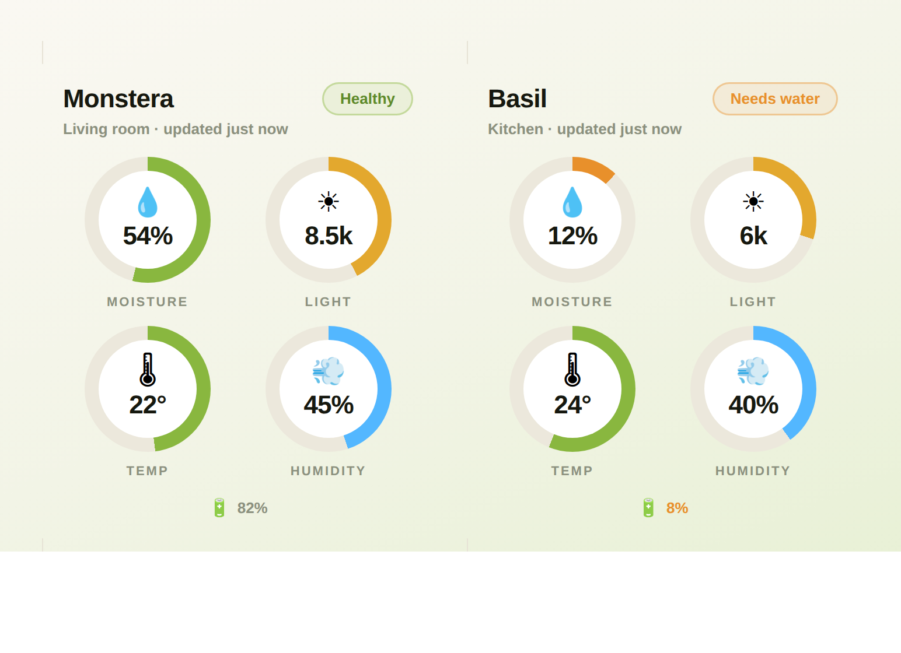

# PlantSense Card

A custom [Lovelace](https://www.home-assistant.io/dashboards/) card for Home
Assistant that shows a PlantSense sensor the way the mobile app does: the plant
name, a **Healthy / Needs water** status pill, and four circular dial gauges for
**soil moisture, light, temperature and humidity** — plus a battery chip.

PlantSense is an **ESPHome-native** device. It's auto-discovered by Home
Assistant on your local network, runs entirely locally, and needs **no
PlantSense cloud account**. This card just reads the entities the device
already exposes.



> _`docs/screenshot.png` is a render of the card in its healthy and needs-water
> states. Swap it for a capture from your own dashboard when you like._

---

## Requirements

- Home Assistant with a PlantSense device adopted via
  [ESPHome](https://www.home-assistant.io/integrations/esphome/) (auto-discovered
  under **Settings → Devices & Services**).
- The device exposes these entities (the `plantsense_xxxxxx` part is your
  device's MAC-suffixed name — copy the real prefix from any of its entities):

  | Dial / field | Entity | Unit |
  |---|---|---|
  | Soil moisture | `sensor.plantsense_xxxxxx_soil_moisture` | % |
  | Temperature (ambient) | `sensor.plantsense_xxxxxx_temperature` | °C |
  | Humidity | `sensor.plantsense_xxxxxx_humidity` | % |
  | Light | `sensor.plantsense_xxxxxx_light` | lux |
  | Battery | `sensor.plantsense_xxxxxx_battery` | % |

---

## Installation

### Option A — HACS (recommended)

This repo is a HACS **Lovelace / Dashboard** plugin.

1. In HACS, open the top-right menu → **Custom repositories**.
2. Add this repository URL and pick category **Dashboard** (a.k.a. Lovelace /
   Plugin).
3. Find **PlantSense Card** in HACS and click **Download**.
4. HACS registers the JS resource for you. Hard-refresh your browser
   (Ctrl/Cmd-Shift-R) so the new card loads.

### Option B — Manual

1. Copy `plantsense-card.js` to `config/www/plantsense-card.js` on your Home
   Assistant instance (the `www/` folder is served at `/local/`).
2. Register it as a dashboard resource — **Settings → Dashboards → ⋮ →
   Resources → Add resource**:
   - **URL:** `/local/plantsense-card.js`
   - **Type:** `JavaScript Module`
   
   (Or in YAML mode, under `lovelace:` → `resources:` add
   `- url: /local/plantsense-card.js` with `type: module`.)
3. Hard-refresh your browser.

---

## Usage

Add a **Manual** card (or pick **PlantSense Card** from the "Add card" picker)
and use:

```yaml
type: custom:plantsense-card
name: Monstera
location: Living room
moisture: sensor.plantsense_a1b2c3_soil_moisture
temperature: sensor.plantsense_a1b2c3_temperature
humidity: sensor.plantsense_a1b2c3_humidity
illuminance: sensor.plantsense_a1b2c3_light
battery: sensor.plantsense_a1b2c3_battery
```

Tapping any dial opens that entity's more-info / history dialog.

### Options

| Option | Type | Default | Description |
|---|---|---|---|
| `name` | string | `PlantSense` | Plant name shown in the header. |
| `location` | string | — | Optional sub-heading (e.g. a room). |
| `moisture` | entity id | — | Soil-moisture sensor (`%`). Drives the status pill. |
| `temperature` | entity id | — | Temperature sensor. |
| `humidity` | entity id | — | Humidity sensor (`%`). |
| `illuminance` | entity id | — | Light sensor (`lux`). Alias: `light`. |
| `battery` | entity id | — | Battery sensor (`%`). Chip hides if unset. |
| `moisture_min` | number | `30` | Below this the pill reads **Needs water** and the moisture ring turns orange. |
| `moisture_max` | number | `70` | Above this the pill reads **Too wet**. |
| `illuminance_max` | number | `20000` | Lux that fills the light ring 100%. |
| `temperature_min` | number | `10` | Value that maps to an empty temperature ring. |
| `temperature_max` | number | `35` | Value that maps to a full temperature ring. |

Any missing or `unavailable` entity renders as `—` with an empty ring; the card
never errors on a partially-configured or offline device.

> **Tune the healthy range per plant.** `30–70%` is a generic houseplant band.
> Succulents want it much lower (~5–15%), tropicals higher. The repo's
> `plantsense-infra/homeassistant/plantsense-plant-thresholds.md` has per-metric
> guidance.

---

## A note on battery devices (deep sleep)

PlantSense is a battery sensor that **deep-sleeps ~90 minutes** between short
wake cycles. Over a persistent ESPHome API connection, Home Assistant marks the
entities *unavailable* while the device sleeps. Two ways to keep the card
showing the latest reading:

- **Mains-powered / always-on unit:** the native ESPHome API stays connected —
  live updates, nothing extra to do.
- **Battery unit:** use the opt-in MQTT path with availability reporting
  disabled, so HA **retains the last value** across the sleep window. See
  `plantsense-esphome/HOME-ASSISTANT.md` for setup.

The card reads the same entity ids either way.

---

## License

Part of the PlantSense project.
